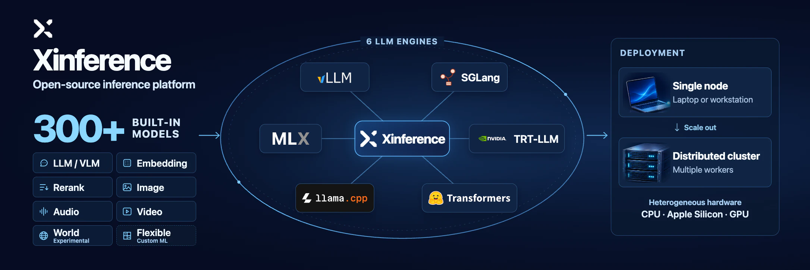
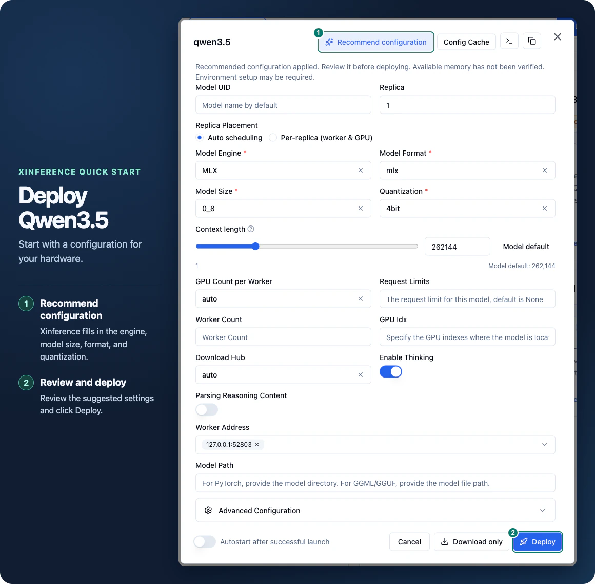
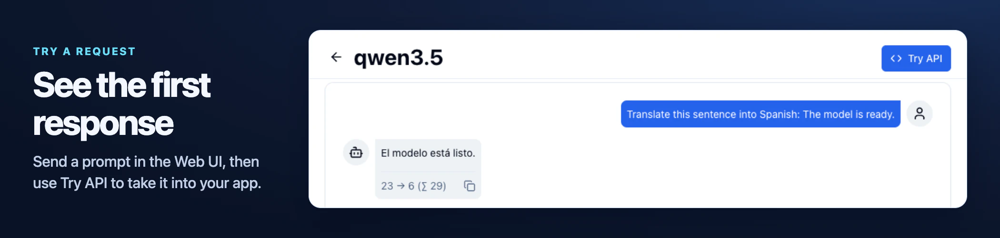
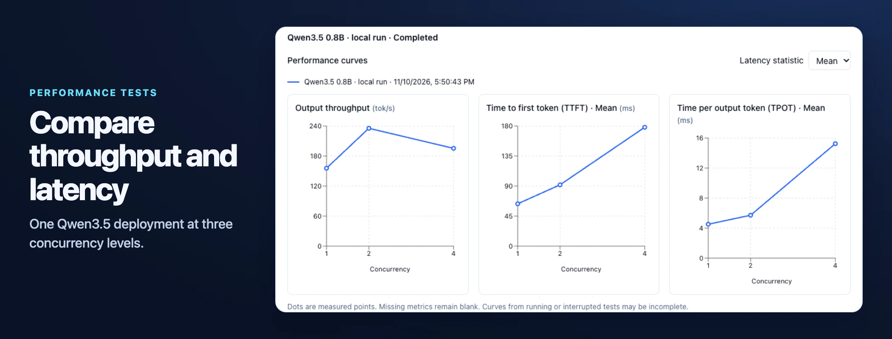

# 

**Xinference (Xorbits Inference) is an open-source distributed inference platform.**

Deploy and run models on heterogeneous hardware, from a local machine to a distributed cluster. Xinference includes 300+ built-in models for language, vision, embeddings, reranking, image, audio, video, and experimental world generation. Register your own models, including traditional ML models through the Flexible type. Manage deployments in the Web UI and use models through OpenAI-compatible APIs, the Python SDK, or the CLI.

[Quick start](#quick-start) · [Key features](#key-features) · [Comparison](#how-xinference-compares) · [Self-hosting](https://inference.readthedocs.io/en/latest/getting_started/installation.html) · [Documentation](https://inference.readthedocs.io/en/latest/) · [Model catalog](https://inference.readthedocs.io/en/latest/models/builtin/index.html) · [Releases](https://github.com/xorbitsai/inference/releases) · [Xinference Enterprise](https://xinference.co/enterprise.html)

[](https://github.com/xorbitsai/inference/releases)
[](https://pypi.org/project/xinference/)
[](https://hub.docker.com/r/xprobe/xinference/tags)
[](https://pypi.org/project/xinference/)
[](https://github.com/xorbitsai/inference/actions/workflows/python.yaml)

[](https://github.com/xorbitsai/inference/blob/main/LICENSE)
[](https://github.com/xorbitsai/inference/stargazers)
[](https://github.com/xorbitsai/inference/forks)
[](https://github.com/xorbitsai/inference/graphs/contributors)
[](https://hub.docker.com/r/xprobe/xinference)
[](https://discord.gg/Xw9tszSkr5)
[](https://t.me/+nCNpwmySwk9iYmI1)
[](https://x.com/Xinference_ai)

**Languages** · **English** · [日本語](./READMES/README_ja_JP.md) · [한국어](./READMES/README_ko.md) · [Deutsch](./READMES/README_de.md) · [Français](./READMES/README_fr.md) · [Español](./READMES/README_es.md) · [Italiano](./READMES/README_it.md) · [Português](./READMES/README_pt_BR.md) · [繁體中文](./READMES/README_zh_TW.md) · [简体中文](./READMES/README_zh_CN.md)

## Quick start

### 1. Start the server

Xinference downloads the model and installs any needed engine dependencies on the first launch.

```bash
pip install xinference
xinference-local --host 127.0.0.1
```

Open [http://127.0.0.1:9997](http://127.0.0.1:9997). On a fresh instance, use the setup token printed in the server log to create an administrator account, then sign in. [First-run setup](https://inference.readthedocs.io/en/latest/user_guide/auth_system.html#initial-admin-account)

### 2. Launch a chat model

In **Launch Model**, search for `qwen3.5` and open its launch form. Click **Recommend configuration** to fill in settings for your hardware. Review the recommendation and click **Deploy**.



### 3. Make your first request

Open the deployed model in **Running Models** to try a prompt in the Web UI. The first instance uses `qwen3.5` as its Model UID. If your instance shows a different UID, use that value for `model` below. Create a key under **API Key Management** to call the API.

```bash
export XINFERENCE_API_KEY="<your-api-key>"
curl --fail-with-body http://127.0.0.1:9997/v1/chat/completions \
  -H "Authorization: Bearer $XINFERENCE_API_KEY" \
  -H "Content-Type: application/json" \
  -d '{
    "model": "qwen3.5",
    "messages": [{"role": "user", "content": "Translate this sentence into Spanish: The model is ready."}],
    "enable_thinking": false,
    "max_tokens": 96
  }'
```



## Key features

| Area | What Xinference supports |
| --- | --- |
| Model catalog | 300+ built-in models across language, vision, embeddings, reranking, images, audio, video, and experimental world generation. Register your own models, including Flexible models for traditional ML. [Model catalog](https://inference.readthedocs.io/en/latest/models/builtin/index.html) |
| Engines and hardware | Choose vLLM, SGLang, TRT-LLM, Transformers, llama.cpp, or MLX for supported LLMs. Hardware support varies by engine and includes CPU, GPUs, Apple Silicon, and supported MLU configurations. [Backends](https://inference.readthedocs.io/en/latest/user_guide/backends.html) · [MLU support](https://github.com/xorbitsai/inference/pull/3693) |
| Distributed serving | Run on one machine, add workers and replicas, or run a large model across workers with a supported engine. Compatible deployments support heterogeneous prefill/decode separation. [Distributed inference](https://inference.readthedocs.io/en/latest/user_guide/distributed_inference.html) · [P/D separation](https://inference.readthedocs.io/en/latest/user_guide/pd_separation.html) |
| APIs and tools | OpenAI- and Anthropic-compatible endpoints, with streaming and tool calling where supported. Deploy and manage models through the Web UI, CLI, or Python SDK. [Client guide](https://inference.readthedocs.io/en/latest/user_guide/client_api.html) · [Tool calling](https://inference.readthedocs.io/en/latest/models/model_abilities/tools.html) |
| Performance and operations | Benchmark running chat models in the Web UI. Supported deployments can share prefix caches with Xavier, change selected runtime settings, and reload replicas one at a time. [Performance tests](https://inference.readthedocs.io/en/latest/user_guide/benchmarks.html) · [Runtime configuration](https://inference.readthedocs.io/en/latest/user_guide/launch.html#reconfigure-without-reloading-weights) |
| Languages | Use the Web UI in English, Simplified Chinese, Traditional Chinese, Japanese, or Korean. The README is available in ten languages. |

## How Xinference compares

| Capability | **Xinference** | LocalAI | KServe | NVIDIA Dynamo |
| --- | :---: | :---: | :---: | :---: |
| **Standalone (no Kubernetes)** | ![Supported][compare-supported] | ![Supported][compare-supported] | ![No documented support][compare-undocumented] | ![Supported][compare-supported] |
| **Multi-node inference** | ![Supported][compare-supported] | ![Supported][compare-supported] | ![Supported][compare-supported] | ![Supported][compare-supported] |
| **CPU / GPU / Apple Metal** | ![Supported][compare-supported] | ![Supported][compare-supported] | ![Partial or via integration][compare-partial] | ![Partial or via integration][compare-partial] |
| **llama.cpp / vLLM / SGLang** | ![Supported][compare-supported] | ![Supported][compare-supported] | ![Partial or via integration][compare-partial] | ![Partial or via integration][compare-partial] |
| **CUDA ↔ Metal prefill/decode** | ![Supported][compare-supported] | ![No documented support][compare-undocumented] | ![No documented support][compare-undocumented] | ![No documented support][compare-undocumented] |
| **Mixed engines under one model ID** | ![Supported][compare-supported] | ![Partial or via integration][compare-partial] | ![Partial or via integration][compare-partial] | ![Partial or via integration][compare-partial] |
| **Rolling reconfiguration with GPU weight reuse** | ![Supported][compare-supported] | ![No documented support][compare-undocumented] | ![No documented support][compare-undocumented] | ![No documented support][compare-undocumented] |
| Model catalog | ![Supported][compare-supported] 300+ | ![Supported][compare-supported] | ![Partial or via integration][compare-partial] | ![Partial or via integration][compare-partial] |
| Model deployment Web UI | ![Supported][compare-supported] | ![Supported][compare-supported] | ![Partial or via integration][compare-partial] | ![No documented support][compare-undocumented] |
| Embeddings and reranking | ![Supported][compare-supported] | ![Supported][compare-supported] | ![Supported][compare-supported] | ![Supported][compare-supported] |
| Image and video generation | ![Supported][compare-supported] | ![Supported][compare-supported] | ![No documented support][compare-undocumented] | ![Supported][compare-supported] |
| Speech recognition and synthesis | ![Supported][compare-supported] | ![Supported][compare-supported] | ![No documented support][compare-undocumented] | ![Partial or via integration][compare-partial] |

![][compare-supported] Supported · ![][compare-partial] Partial or via integration · ![][compare-undocumented] No documented support

<details>
<summary>Scope and sources</summary>

Based on documented features in the open-source releases. Engine and hardware support varies by model. CUDA ↔ Metal prefill/decode requires a compatible model and engine pair.

Xinference can serve replicas with different engines concurrently under one model ID. LocalAI uses an ordered failover chain under one model name and sends requests to the first available target. KServe and Dynamo can route across separate deployments. GPU weight reuse applies to supported vLLM and SGLang configurations.

- **Xinference** · [Model catalog](https://inference.readthedocs.io/en/latest/models/builtin/index.html) · [Backends](https://inference.readthedocs.io/en/latest/user_guide/backends.html) · [Distributed inference](https://inference.readthedocs.io/en/latest/user_guide/distributed_inference.html) · [Cross-engine P/D on CUDA and Metal](https://inference.readthedocs.io/en/latest/user_guide/pd_separation.html#nvidia-and-mlx-cross-engine-p-d) · [Replica engine overrides](https://inference.readthedocs.io/en/latest/user_guide/launch.html#replica) · [Rolling reconfiguration](https://inference.readthedocs.io/en/latest/user_guide/launch.html#reconfigure-and-upgrade-running-models)
- **LocalAI** · [Model and deployment features](https://localai.io/docs/features/index.html) · [Backends and hardware](https://localai.io/docs/reference/index.print.html) · [Distributed mode](https://localai.io/docs/features/distributed-mode/) · [Model aliases and failover](https://localai.io/docs/features/model-failover/index.html)
- **KServe** · [Deployment and hardware](https://kserve.github.io/website/docs/intro) · [Built-in generative runtimes](https://kserve.github.io/website/docs/model-serving/generative-inference/overview) · [Kubeflow model catalog](https://www.kubeflow.org/docs/components/hub/installation/) · [Kubeflow Web UI](https://www.kubeflow.org/docs/ecosystem/kserve/webapp/) · [Canary deployments](https://kserve.github.io/website/docs/model-serving/generative-inference/llmisvc/canary-rollout-observability)
- **NVIDIA Dynamo** · [Deployment, hardware, and engines](https://docs.dynamo.nvidia.com/dynamo) · [Deployment recipes](https://docs.dynamo.nvidia.com/dynamo/recipes/browse) · [Image, video, and speech generation](https://docs.dynamo.nvidia.com/dynamo/diffusion/overview) · [Embedding and reranking support](https://docs.dynamo.nvidia.com/dynamo/reference/releases/v1-6-0) · [Multi-deployment routing](https://docs.dynamo.nvidia.com/dynamo/reference/components/global-router-configuration)

</details>

[compare-supported]: assets/compare-supported.svg
[compare-partial]: assets/compare-partial.svg
[compare-undocumented]: assets/compare-undocumented.svg

## Recent updates

[Read the v4.2.0 release notes](https://github.com/xorbitsai/inference/releases/tag/v4.2.0)

<details>
<summary>Built-in models added in the last two releases (v4.1 and v4.2)</summary>

- Built-in support for [Audio8-TTS-Realistic-0.6b](https://huggingface.co/Edge0/Audio8-TTS-Realistic-0.6b): [#6003](https://github.com/xorbitsai/inference/pull/6003)
- Built-in support for [MiniCPM-OCR-1.0](https://huggingface.co/openbmb/MiniCPM-OCR-1.0): [#5916](https://github.com/xorbitsai/inference/pull/5916)
- Built-in support for [OvisOCR3](https://huggingface.co/ATH-MaaS/OvisOCR3): [#5914](https://github.com/xorbitsai/inference/pull/5914)
- Built-in support for [Unlimited-OCR-2](https://huggingface.co/baidu/Unlimited-OCR-2): [#5913](https://github.com/xorbitsai/inference/pull/5913)
- Built-in support for [FLUX 3 Image Klein](https://huggingface.co/black-forest-labs/flux-3-image-klein): [#5792](https://github.com/xorbitsai/inference/pull/5792)
- Built-in support for FIBO 2.0 series ([Dev](https://huggingface.co/briaai/Fibo-2.0-dev), [Edit Turbo](https://huggingface.co/briaai/Fibo-2.0-edit-turbo)): [#5790](https://github.com/xorbitsai/inference/pull/5790)
- Built-in support for Ming-3.0 TTS series ([Tiny](https://huggingface.co/inclusionAI/Ming-3.0-tts-tiny), [0.5B](https://huggingface.co/inclusionAI/Ming-3.0-tts-0.5B)): [#5788](https://github.com/xorbitsai/inference/pull/5788)
- Built-in support for [Xiaomi-OCR-0](https://huggingface.co/SeerRay-Lab/Xiaomi-OCR-0): [#5764](https://github.com/xorbitsai/inference/pull/5764)
- Built-in support for [MOSS-Image-SFT](https://huggingface.co/OpenMOSS-Team/MOSS-Image-SFT): [#5755](https://github.com/xorbitsai/inference/pull/5755)
- Built-in support for [DeepSeek-V4.1-Flash-1017](https://huggingface.co/deepseek-ai/DeepSeek-V4.1-Flash-1017): [#5753](https://github.com/xorbitsai/inference/pull/5753)
- Built-in support for Iris-3B series ([Base](https://huggingface.co/speridlabs/iris-3b), [Turbo](https://huggingface.co/speridlabs/iris-3b/tree/main/turbo)): [#5686](https://github.com/xorbitsai/inference/pull/5686)
- Built-in support for MiniCPM-V-4.7 series ([1B](https://huggingface.co/openbmb/MiniCPM-V-4.7-1B), [35B-A3B](https://huggingface.co/openbmb/MiniCPM-V-4.7-35B-A3B)): [#5676](https://github.com/xorbitsai/inference/pull/5676)
- Built-in support for Qwen3.8-Flash-Next series ([Base](https://huggingface.co/Qwen/Qwen3.8-Flash-Next), [FP8](https://huggingface.co/Qwen/Qwen3.8-Flash-Next-FP8)): [#5673](https://github.com/xorbitsai/inference/pull/5673)
- Built-in support for GLM-5.3 series ([BF16](https://huggingface.co/zai-org/GLM-5.3-BF16), [FP8](https://huggingface.co/zai-org/GLM-5.3)): [#5666](https://github.com/xorbitsai/inference/pull/5666)
- Built-in support for [Qwen-Image-2.1-Turbo](https://huggingface.co/Qwen/Qwen-Image-2.1-Turbo): [#5665](https://github.com/xorbitsai/inference/pull/5665)
- Built-in support for [DeepSeek-V4.1-Flash](https://huggingface.co/deepseek-ai/DeepSeek-V4.1-Flash): [#5661](https://github.com/xorbitsai/inference/pull/5661)

</details>

## Model performance tests

Open **Performance Tests**, pick a running chat model, and set the concurrency levels you want to test. Compare throughput, time to first token, and time per output token before choosing a serving configuration. [Benchmark guide](https://inference.readthedocs.io/en/latest/user_guide/benchmarks.html)



*Example from a local Qwen3.5-0.8B run. Performance depends on the hardware, engine, and workload.*

## Using Xinference

| If you want to… | Start here |
| --- | --- |
| Install on Linux, macOS, or Windows | [One-command installer](https://inference.readthedocs.io/en/latest/getting_started/installation.html#one-line-install) · [Installation guide](https://inference.readthedocs.io/en/latest/getting_started/installation.html) |
| Run in a container or on Kubernetes | [Docker](https://inference.readthedocs.io/en/latest/getting_started/using_docker_image.html) · [Kubernetes](https://inference.readthedocs.io/en/latest/getting_started/using_kubernetes.html) |
| Register your own model | [Custom models](https://inference.readthedocs.io/en/latest/models/custom.html) |
| Connect an application | [OpenAI-compatible APIs](https://inference.readthedocs.io/en/latest/user_guide/client_api.html#openai-client) · [Xagent](https://github.com/xorbitsai/xagent) · [Dify](https://marketplace.dify.ai/plugin/langgenius/xinference) |

**Apps and frameworks** · [LangChain](https://reference.langchain.com/python/langchain-community/llms/xinference/Xinference) · [LlamaIndex](https://developers.llamaindex.ai/python/framework/integrations/llm/xinference_local_deployment/) · [FastGPT](https://doc.fastgpt.io/en/self-host/custom-models/xinference) · [RAGFlow](https://github.com/infiniflow/ragflow) · [MaxKB](https://github.com/1Panel-dev/MaxKB) · [Chatbox](https://chatboxai.app/)

### Xinference Enterprise

Deploy Xinference Enterprise in your own cloud or data center. Xinference Cloud offers managed dedicated deployments, and the Model API provides hosted model endpoints. [Enterprise overview](https://xinference.co/enterprise.html)

**Business enquiries** · [info@xinference.co](mailto:info@xinference.co?subject=%5BGitHub%5DBusiness%20License%20Inquiry)

## Getting involved

| Platform | What it's for |
| --- | --- |
| [GitHub Issues](https://github.com/xorbitsai/inference/issues) | Report bugs and request features. |
| [Discord](https://discord.gg/Xw9tszSkr5) | Ask questions and discuss Xinference with other users. |
| [Telegram](https://t.me/+nCNpwmySwk9iYmI1) | Chat with the Xinference community. |
| [X](https://x.com/Xinference_ai) | Follow project news and releases. |

## Citation

If you use Xinference in your research, please cite [Xinference: Making Large Model Serving Easy](https://aclanthology.org/2024.emnlp-demo.30/).

```bibtex
@inproceedings{lu2024xinference,
    title = "Xinference: Making Large Model Serving Easy",
    author = "Lu, Weizheng and Xiong, Lingfeng and Zhang, Feng and Qin, Xuye and Chen, Yueguo",
    booktitle = "Proceedings of the 2024 Conference on Empirical Methods in Natural Language Processing: System Demonstrations",
    month = nov,
    year = "2024",
    address = "Miami, Florida, USA",
    publisher = "Association for Computational Linguistics",
    url = "https://aclanthology.org/2024.emnlp-demo.30",
    pages = "291--300",
}
```

## Contributors

Thank you to everyone who helps build Xinference. Open your first pull request to add a model, improve the docs, or fix a bug. [Read the contribution guide](https://inference.readthedocs.io/en/latest/development/contributing_codebase.html).

[](https://github.com/xorbitsai/inference/graphs/contributors)
