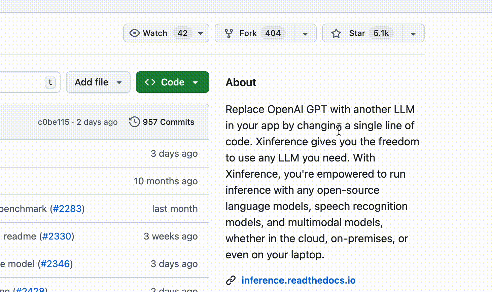
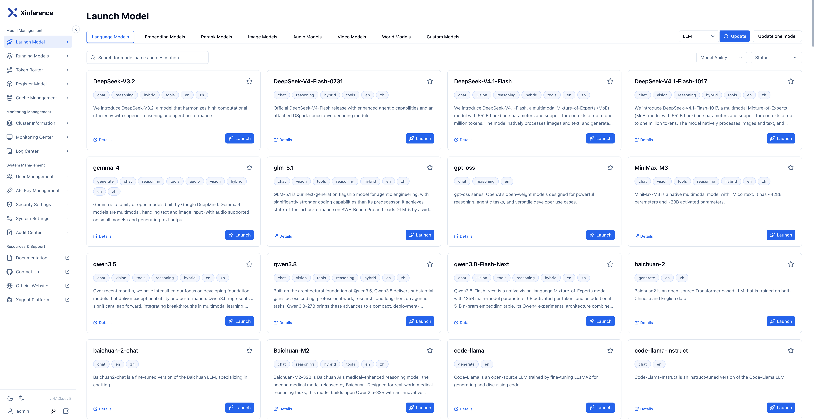

<div align="center">


# Xorbits Inference: Modell-Serving leicht gemacht 🤖

<p align="center">
  <a href="https://xinference.co">Xinference Enterprise</a> ·
  <a href="https://inference.readthedocs.io/en/latest/getting_started/installation.html#installation">Self-Hosting</a> ·
  <a href="https://inference.readthedocs.io/">Dokumentation</a>
</p>

[](https://pypi.org/project/xinference/)
[](https://github.com/xorbitsai/inference/blob/main/LICENSE)
[](https://actions-badge.atrox.dev/xorbitsai/inference/goto?ref=main)
[](https://hub.docker.com/r/xprobe/xinference)
[](https://discord.gg/Xw9tszSkr5)
[](https://t.me/+nCNpwmySwk9iYmI1)
[](https://twitter.com/xorbitsio)

<p align="center">
  <a href="../README.md"></a>
  <a href="./README_ja_JP.md"></a>
  <a href="./README_ko.md"></a>
  <a href="./README_de.md"></a>
  <a href="./README_fr.md"></a>
  <br>
  <a href="./README_es.md"></a>
  <a href="./README_it.md"></a>
  <a href="./README_pt_BR.md"></a>
  <a href="./README_zh_TW.md"></a>
  <a href="./README_zh_CN.md"></a>
</p>
</div>
<br />

Xorbits Inference (Xinference) ist eine leistungsfähige und vielseitige Bibliothek für Sprach-, Spracherkennungs- und multimodale Modelle. Mit Xorbits Inference können Sie Ihr eigenes Modell oder integrierte Spitzenmodelle mit nur einem Befehl bereitstellen und als Dienst veröffentlichen. Forschende, Entwickler und Data Scientists können so das Potenzial moderner KI-Modelle vollständig ausschöpfen.

<div align="center">
<i><a href="https://discord.gg/Xw9tszSkr5">👉 Treten Sie unserer Discord-Community bei!</a> · <a href="https://t.me/+nCNpwmySwk9iYmI1">Treten Sie unserer Telegram-Gruppe bei!</a></i>
</div>

## 🔥 Aktuelle Highlights
### Verbesserungen im Framework
- Xinference 4.0.0 ist mit Multi-Engine-Xavier, heterogener P/D-Trennung und Modell-Neukonfiguration zur Laufzeit verfügbar: [Versionshinweise](https://github.com/xorbitsai/inference/releases/tag/v4.0.0)
- Agent-native Bereitstellung: Xinference ist in [Xagent](https://github.com/xorbitsai/xagent) integriert und ermöglicht dynamische Planung, Tool-Nutzung und eigenständige mehrstufige Inferenz, wodurch die Grenzen statischer Pipelines überwunden werden.
- Automatisches Batching: Mehrere gleichzeitige Anfragen werden automatisch gebündelt, was den Durchsatz deutlich erhöht.: [#4197](https://github.com/xorbitsai/inference/pull/4197)
- [Xllamacpp](https://github.com/xorbitsai/xllamacpp): Neue Python-Bindings für llama.cpp, verwaltet vom Xinference-Team, unterstützen fortlaufendes Batching und sind produktionsfreundlicher.: [#2997](https://github.com/xorbitsai/inference/pull/2997)
- Verteilte Inferenz: Modelle können über Worker verteilt ausgeführt werden: [#2877](https://github.com/xorbitsai/inference/pull/2877)
- Verbesserungen für vLLM: Gemeinsame KV-Cache-Nutzung über mehrere Replikate: [#2732](https://github.com/xorbitsai/inference/pull/2732)
### Neue Modelle
- Integrierte Unterstützung für [FLUX 3 Image Klein](https://huggingface.co/black-forest-labs/flux-3-image-klein): [#5792](https://github.com/xorbitsai/inference/pull/5792)
- Integrierte Unterstützung für die FIBO 2.0-Serie ([Dev](https://huggingface.co/briaai/Fibo-2.0-dev), [Edit Turbo](https://huggingface.co/briaai/Fibo-2.0-edit-turbo)): [#5790](https://github.com/xorbitsai/inference/pull/5790)
- Integrierte Unterstützung für die Ming-3.0 TTS-Serie ([Tiny](https://huggingface.co/inclusionAI/Ming-3.0-tts-tiny), [0.5B](https://huggingface.co/inclusionAI/Ming-3.0-tts-0.5B)): [#5788](https://github.com/xorbitsai/inference/pull/5788)
- Integrierte Unterstützung für [Xiaomi-OCR-0](https://huggingface.co/SeerRay-Lab/Xiaomi-OCR-0): [#5764](https://github.com/xorbitsai/inference/pull/5764)
- Integrierte Unterstützung für [MOSS-Image-SFT](https://huggingface.co/OpenMOSS-Team/MOSS-Image-SFT): [#5755](https://github.com/xorbitsai/inference/pull/5755)
- Integrierte Unterstützung für [DeepSeek-V4.1-Flash-1017](https://huggingface.co/deepseek-ai/DeepSeek-V4.1-Flash-1017): [#5753](https://github.com/xorbitsai/inference/pull/5753)
- Integrierte Unterstützung für die Iris-3B-Serie ([Base](https://huggingface.co/speridlabs/iris-3b), [Turbo](https://huggingface.co/speridlabs/iris-3b/tree/main/turbo)): [#5686](https://github.com/xorbitsai/inference/pull/5686)
- Integrierte Unterstützung für die MiniCPM-V-4.7-Serie ([1B](https://huggingface.co/openbmb/MiniCPM-V-4.7-1B), [35B-A3B](https://huggingface.co/openbmb/MiniCPM-V-4.7-35B-A3B)): [#5676](https://github.com/xorbitsai/inference/pull/5676)
- Integrierte Unterstützung für die Qwen3.8-Flash-Next-Serie ([Base](https://huggingface.co/Qwen/Qwen3.8-Flash-Next), [FP8](https://huggingface.co/Qwen/Qwen3.8-Flash-Next-FP8)): [#5673](https://github.com/xorbitsai/inference/pull/5673)
- Integrierte Unterstützung für die GLM-5.3-Serie ([BF16](https://huggingface.co/zai-org/GLM-5.3-BF16), [FP8](https://huggingface.co/zai-org/GLM-5.3)): [#5666](https://github.com/xorbitsai/inference/pull/5666)
- Integrierte Unterstützung für [Qwen-Image-2.1-Turbo](https://huggingface.co/Qwen/Qwen-Image-2.1-Turbo): [#5665](https://github.com/xorbitsai/inference/pull/5665)
- Integrierte Unterstützung für [DeepSeek-V4.1-Flash](https://huggingface.co/deepseek-ai/DeepSeek-V4.1-Flash): [#5661](https://github.com/xorbitsai/inference/pull/5661)
- Integrierte Unterstützung für [EmbeddingGemma 2](https://huggingface.co/google/embeddinggemma-2): [#5644](https://github.com/xorbitsai/inference/pull/5644)
- Integrierte Unterstützung für [Confucius4-TTS](https://huggingface.co/netease-youdao/Confucius4-TTS): [#5591](https://github.com/xorbitsai/inference/pull/5591)
- Integrierte Unterstützung für [jina-ocr-v1](https://huggingface.co/jinaai/jina-ocr-v1): [#5588](https://github.com/xorbitsai/inference/pull/5588)
### Integrationen
- [Xagent](https://github.com/xorbitsai/xagent): Enterprise-Agentenplattform mit Planung, Speicher und Tool-Integration.
- [Dify](https://docs.dify.ai/advanced/model-configuration/xinference): LLMOps-Plattform zur schnellen Anwendungsentwicklung mit Visualisierung und Bedienoberfläche.
- [FastGPT](https://github.com/labring/FastGPT): LLM-basierte Knowledge-Plattform für Datenverarbeitung und Modellaufrufe.
- [RAGFlow](https://github.com/infiniflow/ragflow): Open-Source-RAG-Engine für tiefes Dokumentenverständnis.
- [MaxKB](https://github.com/1Panel-dev/MaxKB): Open-Source-Wissensdatenbank-Assistent mit RAG-Integration.

## Hauptfunktionen
🌟 **Modell-Serving leicht gemacht**: Vereinfachen Sie die Bereitstellung von LLMs, Spracherkennung und multimodalen Modellen. Tests und Produktionsmodelle lassen sich mit einem einzigen Befehl einrichten und deployen.

⚡️ **State-of-the-art-Modelle einfach nutzbar**: Probieren Sie integrierte Spitzenmodelle mit nur einem Befehl aus. Xinference bietet Zugang zu modernen Open-Source-Modellen.

🖥 **Heterogene Hardware-Unterstützung**: Nutzen Sie GPU und CPU effizient (z. B. über [ggml](https://github.com/ggerganov/ggml)), um Inferenz zu beschleunigen.

⚙️ **Flexible APIs und Schnittstellen**: OpenAI-kompatible RESTful API (inkl. Function Calling), RPC, CLI, Web UI und mehr.

🌐 **Verteiltes Deployment**: Einfache Verteilung von Inferenz über mehrere Geräte und Maschinen.

🔌 **Third-Party-Integrationen**: Nahtlose Integration mit [LangChain](https://python.langchain.com/docs/integrations/providers/xinference), [LlamaIndex], [Dify], [Chatbox] u. a.

## Warum Xinference
| Funktion                                     | Xinference | FastChat | OpenLLM | RayLLM |
|----------------------------------------------|------------|----------|---------|--------|
| OpenAI-kompatible RESTful API                 | ✅         | ✅        | ✅       | ✅      |
| vLLM-Integration                              | ✅         | ✅        | ✅       | ✅      |
| Verschiedene Inferenz-Engines (GGML, TensorRT)| ✅         | ❌        | ✅       | ✅      |
| Verschiedene Plattformen (CPU, Metal)         | ✅         | ✅        | ❌       | ❌      |
| Multi-Node Cluster Deployment                 | ✅         | ❌        | ❌       | ✅      |
| Bildmodelle (Text→Bild)                       | ✅         | ✅        | ❌       | ❌      |
| Text-Embedding-Modelle                        | ✅         | ❌        | ❌       | ❌      |
| Multimodale Modelle                            | ✅         | ❌        | ❌       | ❌      |
| Sprachmodelle                                  | ✅         | ❌        | ❌       | ❌      |
| OpenAI-Funktionalität (Function Calling)      | ✅         | ❌        | ❌       | ❌      |

## Wie man Xinference verwendet

- **Self-Hosting Xinference Community Edition**
  Folgen Sie dem [Starter-Guide](#einstieg), um Xinference lokal zu starten. Details in der Dokumentation: https://inference.readthedocs.io/.

- **Xinference für Unternehmen**
  **Xinference Enterprise** ist die kommerzielle Edition für Teams, die Modelle in Produktionsumgebungen betreiben. Sie können sie in Ihrer eigenen Cloud oder Ihrem Rechenzentrum bereitstellen oder eine verwaltete dedizierte Bereitstellung mit **Xinference Cloud** wählen. Die gehostete **Model API** bietet über eine OpenAI-kompatible API Zugriff auf unterstützte Modelle, ohne dass Sie die Inferenzinfrastruktur verwalten müssen. Mehr erfahren Sie unter [xinference.co](https://xinference.co).
  Für Unternehmensanfragen [kontaktieren Sie uns per E-Mail](mailto:info@xinference.co?subject=[GitHub]Business%20License%20Inquiry).

## Bleiben Sie vorne dabei

Sternen Sie Xinference auf GitHub, um Release-Updates zu erhalten.



## Einstieg

* [Dokumentation](https://inference.readthedocs.io/en/latest/index.html)
* [Integrierte Modelle](https://inference.readthedocs.io/en/latest/models/builtin/index.html)
* [Custom-Modelle](https://inference.readthedocs.io/en/latest/models/custom.html)
* [Deployment-Dokumentation](https://inference.readthedocs.io/en/latest/getting_started/using_xinference.html)

### Quickstart

**pip**

```bash
pip install xinference
xinference-local
```

**Installation mit einem Befehl**

Linux/macOS:

```bash
curl -fsSL https://raw.githubusercontent.com/xorbitsai/inference/main/scripts/install.sh | sh
```

Windows PowerShell:

```powershell
irm https://raw.githubusercontent.com/xorbitsai/inference/main/scripts/install.ps1 | iex
```

[Installationsanleitung](https://inference.readthedocs.io/en/latest/getting_started/installation.html#one-line-install) · [Nutzungsanleitung](https://inference.readthedocs.io/en/latest/getting_started/using_xinference.html#run-xinference-locally)

### Docker

NVIDIA-GPU-Benutzer können das [Xinference Docker Image](https://inference.readthedocs.io/en/latest/getting_started/using_docker_image.html) verwenden. Stellen Sie sicher, dass Docker und CUDA vor der Installation vorhanden sind.

```bash
docker run --name xinference -d -p 9997:9997 -e XINFERENCE_HOME=/data -v </on/your/host>:/data --gpus all xprobe/xinference:latest xinference-local -H 0.0.0.0
```

### K8s (Helm)

Nach Aktivierung von GPU im Kubernetes-Cluster installieren Sie wie folgt:

```
# Repository hinzufügen
helm repo add xinference https://xorbitsai.github.io/xinference-helm-charts

# Index aktualisieren und Version prüfen
helm repo update xinference
helm search repo xinference/xinference --devel --versions

# Xinference installieren
helm install xinference xinference/xinference -n xinference --version 0.0.1-v<xinference_release_version>
```

Weitere K8s-Optionen finden Sie in der Dokumentation.



## Mitmachen

| Plattform                                                                 | Zweck                                   |
|---------------------------------------------------------------------------|-----------------------------------------|
| [Github Issues](https://github.com/xorbitsai/inference/issues)             | Bug-Reports und Feature-Anfragen        |
| [Discord](https://discord.gg/Xw9tszSkr5)                                  | Zusammenarbeit mit anderen Anwendern    |
| [Telegram](https://t.me/+nCNpwmySwk9iYmI1)                                | Diskussionen mit der Community          |
| [Twitter](https://twitter.com/xorbitsio)                                  | Neuigkeiten und Ankündigungen           |

## Zitation

Wenn dieses Projekt hilfreich war, zitieren Sie bitte wie folgt:

```bibtex
@inproceedings{lu2024xinference,
    title = "Xinference: Making Large Model Serving Easy",
    author = "Lu, Weizheng and Xiong, Lingfeng and Zhang, Feng and Qin, Xuye and Chen, Yueguo",
    booktitle = "Proceedings of the 2024 Conference on Empirical Methods in Natural Language Processing: System Demonstrations",
    month = nov,
    year = "2024",
    address = "Miami, Florida, USA",
    publisher = "Association for Computational Linguistics",
    url = "https://aclanthology.org/2024.emnlp-demo.30",
    pages = "291--300",
}
```

## Mitwirkende

<a href="https://github.com/xorbitsai/inference/graphs/contributors">
  
</a>

## Star-Verlauf

[](https://star-history.dera.page/#xorbitsai/inference&Date)
